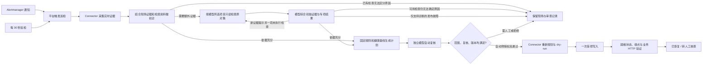

# KubePilot v0.2：三步接入的 B/S 排障平台

本版采用浏览器 + Go 平台服务 + 集群内 Connector。用户选择的接入方式是 Alertmanager Webhook 和集群内 Connector。模型使用支持工具调用的 OpenAI 兼容 Chat Completions API，例如 DeepSeek。

界面沿用上一版 TypeSafe Playground 参考风格：深色窄侧栏、顶部工具栏、左侧三步配置及右侧指南。侧栏可收起；平板切换“接入配置 / 接入指南”，手机使用底部导航。故障中心和操作记录沿用相同的字体、边框与控件规则。

平台负责告警归档、诊断、独立自动复核、任务编排和记录；Connector 主动连接平台，补采现场证据并调用 Kubernetes API。浏览器和平台都不需要保存 kubeconfig，也不需要额外一台常驻控制机。初次安装仍需要有权限的管理员执行一次 `kubectl apply`。

## 个人排障知识库

打开侧栏「知识库」可查看内置手册、导入已脱敏的 Markdown 或 TXT 文件，也可直接粘贴复盘记录。建议写明事件原文、适用条件、核查方法和恢复判据。导入后可用错误码、事件原因或中文关键词试查，例如 `FailedCreate`。每个空间支持 16 份自有资料，每份最多 32 KiB。

平台按 Markdown 标题切分段落，在本机用 BM25 检索中文双字词和英文标识符。每轮最多取 3 段，初诊使用当前故障现象，补查后用更新的现场证据再检索，独立复核同时考虑拟执行的动作。命中段落随请求发送到已配置的模型，故障详情可展开查看实际送入该轮的内容和版本。知识库提供核查线索，证据编号、动作授权、基线及业务恢复验证仍由原流程检查。

自有资料随工作空间加密保存在 `knowledge.enc`，依赖同目录的 `master.key`。新增、移除用于后续新诊断，已开始的诊断使用启动时的索引，历史记录保留实际送入的段落。无需另装向量数据库或配置嵌入模型。

## 本机打开

在项目目录运行：

```powershell
.\scripts\start-platform.ps1
```

打开 http://127.0.0.1:18081 。已有构建时可添加 `-SkipBuild`。停止用 `scripts/stop-platform.ps1`，配置和记录会保留。v0.1 实验版仍使用原来的 `scripts/start.ps1` 和 18080 端口，两版数据分开。

本机脚本只监听 loopback，供浏览器查看与开发。要接入真实集群，必须先把平台部署在 Alertmanager 和 Connector 可访问的地址，不能把电脑的 `127.0.0.1` 当成集群内可达地址。

需要模拟消息输入与执行端回传时，使用 [三个独立脚本](../scripts/mock/README.md)：发送 Alertmanager 格式告警，轮询当前平台的任务接口，回传采集与修复的模拟结果。脚本直接连接当前服务，过程仍可在现有页面查看。

## 注册、登录与个人工作空间

首次打开进入登录页，点击“注册账号”。注册只填写用户名、密码和确认密码，不设置显示名称；注册成功后自动登录，再创建一个个人工作空间。工作空间名称必填、描述选填，名称默认建议为“用户名的工作空间”，头像使用用户名首字。用户名支持 3–32 个中英文字、数字、下划线和短横线；英文不区分大小写。密码为 12–128 个字符，不强制拼凑字符类型。

每个账号只拥有一个个人工作空间；重复提交创建请求返回已有空间，不产生副本。空间使用独立 ID，名称允许重名，也与 Kubernetes 命名空间无关。左下角账号入口或手机顶栏设置入口提供连接状态、空间名称/描述修改、修改密码和退出登录。没有团队邀请、角色分工或空间切换功能。

登录后，没有空间时进入创建页；接入未完成时回到尚未完成的步骤；三步接入与健康基线验证完成后，点击“完成接入并进入故障中心”，后续登录直接进入故障中心。刷新保留登录和已保存配置，不保留未提交的密码、密钥或表单草稿。

浏览器使用服务端会话和 HttpOnly、SameSite=Strict Cookie，12 小时到期；HTTPS 使用 Secure 和 `__Host-` Cookie。会话令牌仅以摘要保存，每个账号最多保留五个有效会话。退出使当前会话失效，修改或管理员重置密码使该账号全部会话失效。登录错误统一提示，注册和登录有次数及并发限制。多个标签页同步账号变化；旧账号页面携带的账号/空间标识与当前会话不一致时，服务端拒绝操作。

每个空间的模型配置、Webhook/Connector 凭证、任务、告警、故障与记录分别持久化。管理接口从会话确定归属，不接受客户端指定其他所有者；外部接入根据各自的专用令牌路由到对应空间。退出登录不停止已授权的后台任务；暂停自动修复使用故障中心的独立操作。

密码使用独立随机盐和 PBKDF2-HMAC-SHA256（600,000 次）摘要，不存明文。参数参考 [OWASP Password Storage Cheat Sheet](https://cheatsheetseries.owasp.org/cheatsheets/Password_Storage_Cheat_Sheet.html)，实现使用 [Go crypto/pbkdf2](https://go.dev/pkg/crypto/pbkdf2/)。账号注册适用于自主管理的实验平台；这不等于已完成面向不可信用户的公网 SaaS 安全评估。可在预期用户注册后设置 `PLATFORM_REGISTRATION_CLOSED=true` 并重启，关闭新注册。

### 忘记密码与管理员维护

不接入邮箱和短信。账号密码由能够访问平台服务器数据目录的部署管理员重置。以下命令在项目目录执行，先停止平台；密码在交互终端中隐藏输入，不放进命令行参数：

```powershell
.\scripts\stop-platform.ps1
.\bin\kubepilot-platform.exe reset-password --username 实际用户名
.\scripts\start-platform.ps1 -SkipBuild
```

Linux 执行同一二进制的 `reset-password --data 实际数据目录 --username 实际用户名` 子命令。受控自动化可用 `--password-stdin` 从标准输入提供两行相同的新密码，避免将密码放入参数或日志。服务与维护命令共享操作系统文件锁，平台运行期间维护命令会拒绝写入；进程退出后锁自动释放。

### 旧版本数据如何归属

升级不会把旧版 `data/platform/platform.enc` 自动分配给首个注册账号。未分配的旧空间原样保留，不调度后台任务，也不接受原有外部凭证。新注册账号可以创建全新的空空间。

需要继续使用旧配置时，先注册目标账号，再由部署管理员停止服务并执行：

```powershell
.\scripts\stop-platform.ps1
.\bin\kubepilot-platform.exe claim-legacy --username 实际用户名
.\scripts\start-platform.ps1 -SkipBuild
```

目标账号必须尚未创建空间，或其空间没有接入配置与业务数据。认领只建立显式归属，不删除旧文件；已分配的旧空间不能再次认领，已有新配置也不会被覆盖。认领会暂停自动修复，保留历史记录和已有接入凭证；重新登录后核对授权范围，再决定是否重新授权自动执行。

## 创建空间后完成三步接入

### 1. 转发告警

在“接入设置 → 接入告警”填写平台对集群可达的地址，生成接收配置。将其中的 receiver 合并进现有 Alertmanager 配置，把需要处理的告警路由到 `kubepilot`，然后重新加载 Alertmanager。不要直接覆盖原有 receivers 或 route。

接收端为 `POST /ingest/alertmanager`，使用专用 Bearer 令牌。这个令牌只能发送告警，不能调用管理或执行接口。页面分别显示“已生成配置”和“已收到告警”。发送重复通知会累加接收次数，不重复创建同一条通知。告警里的 `resolved` 仅表示告警通知恢复，不等于已经验证业务恢复。

协议参照 [Alertmanager webhook_config](https://prometheus.io/docs/alerting/latest/configuration/#webhook_config)，本版接收 v4 JSON 通知，每次最多 100 条，正文上限 2 MiB。

### 2. 接入模型

填写 API 基地址、模型名称、API Key，点击“测试连接并保存”。使用服务商当前提供的、支持函数工具调用的模型名称。基地址不需要附加 `/chat/completions`。

测试会真正调用一次 `connection_check` 工具；只有响应格式和参数有效才保存。诊断和复核分别发起新的请求，不共享对话历史。独立上下文不等于两个模型完全独立，二者仍可能犯同类错误，因此程序规则和执行端复检才是最终权限边界。接口行为参照 [DeepSeek 工具调用文档](https://api-docs.deepseek.com/guides/tool_calls/)。

API Key 不进入 Connector 配置或浏览器持久存储，服务端保存后不回显；留空保留已有密钥。诊断会把经现有采集器处理的资源信息、相关日志证据、基线差异发给配置的模型服务。应只授权适合发送这些数据的应用和模型服务。

### 3. 安装执行端并授权

填写业务命名空间、管理员提供的 Connector 镜像、允许操作的 Deployment / Service 名称及业务健康检查 URL。选择允许的恢复动作，决定是否预先授权自动执行，然后下载 YAML，在有集群管理权限的位置执行：

```sh
kubectl apply -f kubepilot-connector.yaml
kubectl -n <业务命名空间> get pods,pvc -l app=kubepilot-connector
kubectl -n <业务命名空间> logs deployment/kubepilot-connector
```

PVC 的名称为 `kubepilot-connector-data`，可单独通过 `kubectl -n <业务命名空间> get pvc kubepilot-connector-data` 查看。所有命名空间及业务对象必须预先存在。

清单创建 ServiceAccount、Role、RoleBinding、连接 Secret、1 GiB PVC 和单副本 Deployment。Connector 使用 [Pod 内的 ServiceAccount](https://kubernetes.io/docs/tasks/configure-pod-container/configure-service-account/) 访问 Kubernetes API。它主动轮询平台，不需要公开 Connector 端口。

权限是业务命名空间内的资源与日志读取，以及按 `resourceNames` 精确限定的 Deployment / Service 更新；没有 cluster-admin、Secrets 读取、Pod exec、删除或节点写权限。Kubernetes RBAC 无法直接限制 update 的字段，允许字段仍由程序的固定计划生成器和执行前复检限制。

平台必须收到 Connector 心跳和健康基线状态才显示接入就绪。初次建立基线要求资源就绪、关联端点有效且业务 HTTP 探测成功；已故障的资源不能直接录为健康基线。先在业务健康时安装，再做故障实验。

现有基线不会自动被新配置覆盖。对象重建导致 UID 改变时会停止自动修复；本版尚无基线版本迁移界面，需要人工处理并核对当前健康配置。不要通过删除 Connector 的持久化数据规避执行记录或更新基线。

重新生成授权清单会轮换 Connector 令牌，并使旧部署失效，需要重新 apply。暂停自动修复立即阻止后续自动写任务，已领取或提交的操作仍须核对验证结果；重新启用通过第三步重新授权。

## 平台管理员需要提前准备什么

“三步”从平台可用、已有 Alertmanager 和业务集群开始，不包含搭建 Kubernetes、安装监控、发布镜像或配置网络。

- 平台服务及其可达地址。外部监听必须设置 `PLATFORM_PUBLIC_ORIGIN` 为浏览器访问的完整源地址（协议、主机、端口，不带路径）。浏览器通过注册账号登录，旧 `PLATFORM_ADMIN_TOKEN` 不能绕过账号鉴权。每个账号有一个独立空间，每个空间连接一个 Connector 与业务命名空间。
- 可供集群拉取的 Connector 镜像；kind 可以加载本地镜像。
- 业务命名空间、待授权的应用和集群内可访问的健康检查地址。
- 能为 PVC 提供持久存储的 StorageClass。没有默认 StorageClass 时，管理员需在生成清单的 PVC 中指定现有 `storageClassName`。
- 平台到模型 API、Connector 到平台/Kubernetes API/业务探测 URL 的网络通路。跨主机部署由反向代理终止 HTTPS；仅在明确选择的本地实验中允许 HTTP。

### Docker 构建和部署

```sh
docker build -f Dockerfile.platform --target connector -t kubepilot-connector:0.2.0 .
# kind 实验集群，名称按实际填写
kind load docker-image kubepilot-connector:0.2.0 --name <kind集群名称>
# 其他集群：给镜像加上自己的仓库地址、推送，再在第三步填写该地址
```

将 `.env.platform.example` 复制为 `.env.platform`。示例使用 loopback 地址并显式允许本地 HTTP；跨主机使用时设置 `PLATFORM_PUBLIC_ORIGIN=https://实际平台域名`、`PLATFORM_ALLOW_HTTP=false`，在前置代理配置 HTTPS 并保留原始公开 Host。平台不会信任任意客户端传入的转发头。只有明确的隔离实验网络才使用 `PLATFORM_ALLOW_HTTP=true`。按网络方案设置 `PLATFORM_BIND`，再执行：

```sh
docker compose --env-file .env.platform -f compose.platform.yaml up -d --build
```

平台和 Connector 都以非 root 身份运行。平台数据卷内 `identity/` 保存加密账号与会话，各空间存于 `workspaces/<内部ID>/`，已认领的旧空间仍位于数据根目录。每处密文与对应 `master.key` 必须成对备份，建议备份整个数据目录。AES-GCM 防止状态文件直接暴露密钥或被无声篡改，但密钥与密文位于同一主机，不能防御主机失陷。Windows 本地文件权限还取决于目录 ACL。平台持久化设计为单实例，不要让多个平台进程共用一个数据目录。


## 自动处理的实际边界



Service 可补查后端与端口、目标事件两项。Deployment 可补查发布状态与副本集、容器退出状态、目标事件三项。每轮收到 Connector 返回的结果后，模型可以请求尚未执行的检查、提交诊断或指出仍需人工核查的证据。继续调查和建议进入计划阶段都必须引用本轮新增证据。每个目标的每项检查最多执行一次，专项检查前后校验 UID 和资源版本。故障中心的「补查记录」保留各轮判断、引用的证据编号、下一步检查和检索到的参考资料。

Deployment 出现副本创建失败或超过发布期限时，即使没有产生 Pod，平台也可建立发布故障事件并调查。这类事件仅生成诊断和人工处置建议。自动动作只包括恢复可信基线中的容器镜像、Service 选择器和健康检查配置。

每次计划绑定对象 UID、resourceVersion、基线 ID 和计划哈希。复核意见 10 分钟内有效；执行前平台和 Connector 均重新规划，任何差异都会停止。真实写操作之前还会进行 Kubernetes [dry-run](https://kubernetes.io/docs/reference/using-api/api-concepts/#dry-run)。

一个事件最多尝试一次写操作。任务有持久化租约，平台重启不重派已有任务；Connector 在调用写入前持久化执行记录。超时后结果可能不确定，此时转人工核对，不把“未收到成功”当作“集群没有改变”，也不自动重试写入。已失败或结果不确定的事件不能靠“重新诊断”绕过这项限制。

每轮巡检串行处理一个待诊断事件。模型不通、复核格式无效、证据不足、版本变更、目标超出授权、无可信基线、业务验证失败，均停止自动处理。模型明确拒绝的计划没有人工强行执行按钮；人工核查意见可以由管理员核对具体差异后确认。此版本不自动扩缩容、删除 Pod、改网络策略、操作节点或处理控制平面。

## API 与源代码

| 接口 / 目录 | 作用 |
|---|---|
| `GET /api/auth/session` | 当前账号、个人空间及注册开关，匿名时不返回身份数据 |
| `POST /api/auth/register`、`/login`、`/logout` | 注册、登录、退出 |
| `POST /api/auth/password` | 校验当前密码后修改并撤销全部会话 |
| `POST /api/workspace/create`、`/update`、`/complete` | 创建个人空间、修改名称描述、验证接入完成 |
| `GET /api/platform/state` | 脱敏设置、连接状态、故障和操作记录 |
| `POST /api/platform/setup/source` | 保存平台地址、生成 Alertmanager receiver |
| `POST /api/platform/setup/model` | 真实模型工具调用探测后保存 |
| `POST /api/platform/setup/connector` | 保存授权、轮换令牌、生成部署清单 |
| `POST /api/platform/scan` | 请求实时巡检 |
| `POST /api/platform/pause` | 暂停后续自动修复 |
| `POST /api/platform/cases/{id}/retry` | 补采证据后重新诊断、复核 |
| `POST /api/platform/cases/{id}/approve` | 按计划哈希确认一次具体执行 |
| `POST /ingest/alertmanager` | 仅 Webhook 凭证可调用 |
| `POST /connector/poll`、`/connector/result` | 仅 Connector 凭证可调用 |
| `internal/platform` | 加密状态、编排、令牌隔离、HTTP、部署清单 |
| `internal/connector` | 任务校验、执行去重、采集与结果回传 |
| `internal/providers` | 复用 Kubernetes 精确修复和 OpenAI 兼容适配器 |
| `web/src/AccountApp.vue` | 注册、登录、创建空间与会话恢复 |
| `web/src/PlatformApp.vue` | 三步接入、故障中心、审查详情、操作记录 |

管理接口需要有效的账号会话，本机 loopback 也不能绕过登录。所有管理写接口要求同源 JSON 和 `X-Requested-With: KubePilot`；登录/注册正文限制为 16 KiB。Webhook 和 Connector 令牌相互隔离，不能用于账号登录或管理接口。部署清单本身包含 Connector 凭证，下载后按敏感配置保存，不要提交到 Git。

## 开发验证

在项目根目录运行 Go 测试和静态检查，然后安装前端依赖并构建页面。

```sh
go test ./... -count=1 -timeout 90s
go vet ./...
cd web
npm ci
npm run build
```
